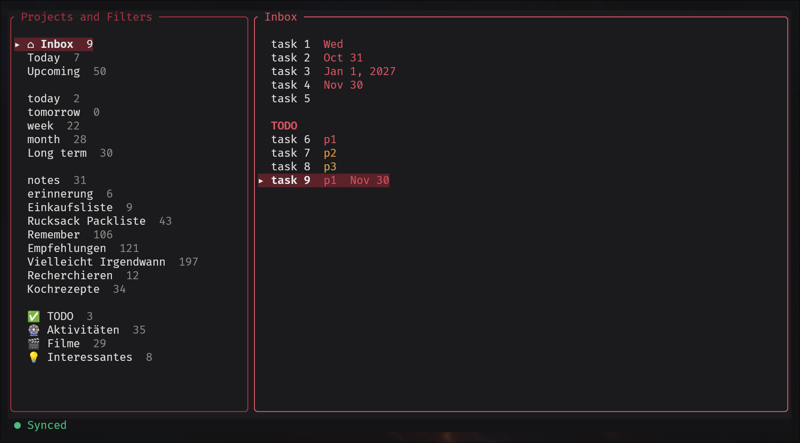
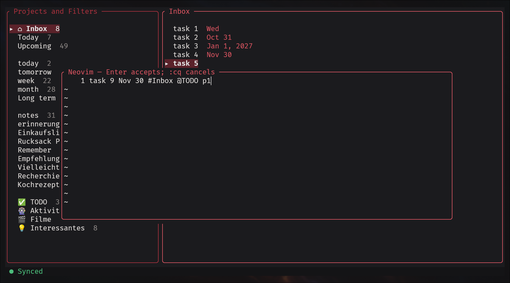
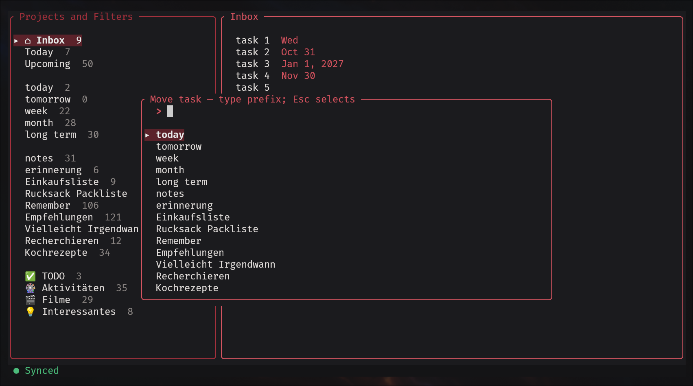
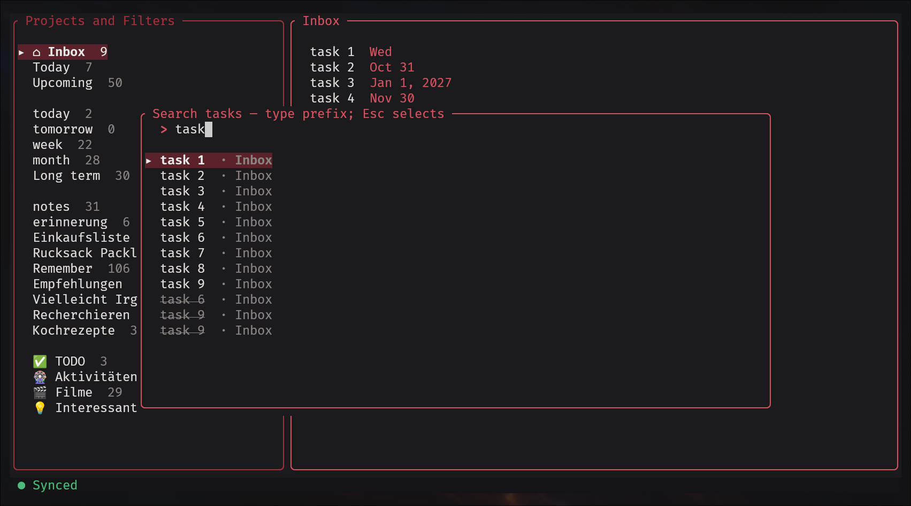

# todoist-tui

Do you love Todoist, the terminal, and Neovim, but wish Todoist had customizable keyboard shortcuts? Then `todoist-tui` might be exactly what you're looking for.

`todoist-tui` is a keyboard-driven terminal interface for Todoist, written in Rust. It features Vim-like keybindings and a rich set of shortcuts that let you navigate projects and manage tasks quickly and efficiently. Every shortcut is fully customizable through a configuration file. And the best part? Tasks can be added and edited directly in embedded Neovim instances.

`todoist-tui` is a fast, offline-first Todoist client. It keeps a local SQLite
cache, applies changes immediately, and synchronizes with Todoist in the
background. The interface uses Vim-style navigation and embeds your normal
Neovim configuration for task and due-date editing.

<p align="center">
  
  
</p>
<p align="center">
  
  
</p>

## Features

- Fully usable offline; queued changes survive restarts.
- Non-blocking background synchronization every 60 seconds, with immediate
  sync after local changes and clear status reporting.
- Inbox, Today, Upcoming, projects, favorite filters, labels, due dates,
  priorities, and Quick Add.
- Nested projects and subtasks remain directly below their parent and are
  visually indented.
- Ten project spaces plus a persistent, collapsible hidden-project group.
- Optional label grouping and alphabetical task ordering.
- Configurable keybindings and an in-app `?` help screen.
- Optional Quick Add shortcuts with per-key fallback projects.
- Offline-first creation and editing of personal Todoist filters.

## Requirements

- Rust 1.88 or newer
- Neovim (`nvim`) on `PATH`
- A clipboard helper: `wl-copy` from `wl-clipboard` on Wayland, or `xclip` or
  `xsel` on X11
- A Todoist API token for synchronization; the application also works without
  one in local-only mode

## Install and run

```sh
git clone https://github.com/HartmutFritz/todoist-tui.git
cd todoist-tui
cargo build --release
./target/release/todoist-tui
```

Create `API_TOKEN` beside `Cargo.toml` to enable synchronization:

```sh
printf '%s\n' 'your-todoist-api-token' > API_TOKEN
chmod 600 API_TOKEN
```

`TODOIST_API_TOKEN` can be used instead and takes precedence over the file.
Tokens are never printed or logged. Without a token, `todoist-tui` starts
normally and keeps changes locally.

## Interface

The left pane contains Inbox, the built-in Today and Upcoming views, favorite
filters, and projects. Today includes overdue tasks and tasks due today.
Upcoming shows the next seven days, grouped chronologically under date
headings. Both views are calculated from the local cache and remain available
offline. The right pane contains tasks for the selected view, and its selection
is remembered independently for every view.

Projects are organized into spaces `0` through `9`:

- Inbox, Today, Upcoming, and favorite filters are always at the top of space
  `0`.
- Personal projects default to space `1`.
- Team/shared projects default to space `2`.
- `Ctrl+0` through `Ctrl+9` assigns or removes a local space override.
- `Ctrl+I` adds or removes the selected Inbox, Today, Upcoming, favorite filter,
  or project from the hidden group. `Shift+I` shows or hides that group.

Nested projects are shown directly below their parent and indented by two
spaces per level.

Tasks are grouped by label by default. `L` toggles grouping and `A` toggles
alphabetical ordering. The modes are independent, so enabling both sorts tasks
alphabetically inside alphabetical label groups. Disabling both restores
Todoist order. Both choices are remembered across application restarts.
Subtasks stay directly below their parent and are indented by two spaces per
level. A task tree belongs to its top-level parent's label group; subtask labels
do not split the tree. Alphabetical mode sorts siblings while keeping the tree
together. Long task titles wrap at complete-word boundaries; continuation lines
are indented by one additional character so they remain visually attached to
the same task. Assigned tasks show the assignee as `@Full Name` on the right;
assignee names are cached and remain visible offline.

`Shift+C` shows or hides completed tasks; this choice is remembered too. Completed
tasks are grey and struck through. Press `d` on one to reopen it. Sync imports
completed tasks from the previous 89 days in addition to retaining the local
offline history.

`u` undoes the most recent task change from the current session. `Ctrl+R`
redoes an undone change. Adding, editing, changing due dates or labels,
completing/reopening, and moving tasks are included. A new task change clears
the redo history.

The bottom-left sync indicator is always visible:

- Green: synchronized and online.
- Orange: syncing or local changes are pending.
- Grey: Todoist is unreachable.
- Red: an actionable error, such as a missing/rejected token or API/storage
  failure. The accompanying text explains the problem.

Temporary action messages beside the indicator disappear after five seconds;
synchronization messages and errors remain visible until the state changes.

With an API token configured, synchronization starts at launch and repeats in
the background every 60 seconds. These scheduled refreshes are silent unless
they fail. Press `r` to synchronize immediately unless an actual project is
selected in the focused project pane, where it opens the rename editor.

## Editing tasks

Press `a` to add a task at the top or `q` to add it at the bottom when using
Todoist order. With label grouping enabled, this means the top or bottom of the
task's label group. Alphabetical ordering and grouped virtual views determine
placement themselves. Both keys open a compact Neovim window in Insert mode
that accepts a Todoist Quick Add expression:

```text
Buy milk tomorrow at 9 #Shopping @errands p1
```

The first line is the Quick Add expression. Move down to the precreated second
line to enter the task description; any further lines also remain part of the
description.

From a filter, Inbox is the fallback project unless the expression names
another project. The full expression is queued unchanged when offline.

Press `c` on a task to create a subtask beneath it with the same Neovim Quick
Add editor. Press `>` to indent the selected task beneath its preceding sibling,
or `<` to promote it one level. These operations work at every nesting depth,
are available offline, and can be undone and redone.

Optional special-add bindings open the same Quick Add editor but use a
configured project as the fallback. For example, pressing `w` can default the
new task to `#week`. A `#Project` typed in the Quick Add expression always
takes precedence over that fallback.

Press `e` to edit a task. The first line accepts Todoist Quick Add syntax, so
dates, projects, labels, and priorities can be written naturally while editing.
Metadata not mentioned in the expression is preserved. Remaining lines are the
task description. When a task has no description yet, an empty description
line is already present: press the Down arrow in Insert mode, type the
description, and press `Enter` to save. Edits are stored offline and parsed by Todoist during the
next synchronization. Press `t` from the task list or an open task-details
window to edit only the due date using Todoist natural language, such as `tod`,
`tomorrow at 9`, or `every Friday`.

Press `T` to remove the selected task's due date immediately. Press `D` to
delete the selected task and its subtasks. Deletion participates in undo and
redo, so `u` restores the deleted task tree and `Ctrl+R` deletes it again.

All editors start in Insert mode with the cursor at the useful editing
position. `Enter` saves in Insert or Normal mode; any other successful write
also accepts the value. Two consecutive `Esc` presses within 400 ms cancel the
editor; separated presses retain normal Neovim behavior. `:cq` also cancels.
Neovim loads your normal user configuration, plugins, and mappings.

Press `@` to search labels and toggle one on the selected task. Press `v` to
search projects and move the selected task. In either picker:

- Type a name prefix and press `Enter`, or
- press `Esc` once, choose with `j`/`k`, and press `Enter`.
- Press `Esc` again from selection mode to cancel.

Press `f` to search every task in the local cache, including cached completed
tasks. Search uses the same prefix and `Esc` selection behavior. `Enter` opens
the selected task's details, and `e` edits it in Neovim. The same key also works
from the regular task-details dialog.

## Managing filters

Press `Shift+F` to search every cached filter, including filters that are not
favorites. Type a name prefix or press `Esc` once to select with `j`/`k`;
`Enter` opens the filter details. Press `e` there to edit the filter in
Neovim. Frozen filters are shown as read-only.

Press `Ctrl+F` to add a personal filter. Filter creation and editing use exactly
three lines:

```text
Filter title
(today | overdue) & #Work
favorite = true
```

The title and Todoist filter query must be non-empty, and the third line accepts
only `true` or `false`. When adding a filter, use the arrow keys to move between
the three pre-created lines; as in the other editors, `Enter` saves. Changes are
applied locally first and queued for
background synchronization. Non-favorite filters remain searchable but are not
shown in the project column.

## Managing projects

With the project pane focused, press `r` on a project to rename it in Neovim.
Inbox, Today, Upcoming, and filters cannot be renamed. Press `Shift+P` to add a
new root-level personal project. Project creation and renaming are applied
locally first, remain available offline, and synchronize in the background.

Press `Shift+J` or `Shift+K` to move a project down or up among projects with the
same parent and in the same todoist-tui group. The complete sibling order is
kept locally, including currently hidden projects, and queued for Todoist so
the resulting order also appears in other Todoist clients.

With the task pane focused, the same keys move an active task down or up among
eligible siblings and synchronize that order to Todoist. Label-grouped root
tasks remain within their label group, and Upcoming root tasks remain within
their date group. Disable alphabetical sorting before manually reordering
tasks, since alphabetical mode determines their visible order.

## Default keybindings

Press `?` to see the active bindings and configuration path. Scroll the help
window with `j`/`k` (or the configured down/up bindings).

| Key | Action |
| --- | --- |
| `j` / `Down` | Move down |
| `k` / `Up` | Move up |
| `h` / `l` | Focus projects / tasks |
| `Enter` | Enter the task pane or show task details |
| `p` | Search all projects, including hidden projects, and jump to one |
| `f` | Search all locally cached tasks |
| `Shift+F` | Search all cached filters |
| `Ctrl+F` | Add a personal filter |
| `r` in project pane | Rename the selected project |
| `Shift+P` | Add a personal project |
| `Shift+J` / `Shift+K` | Move the selected project or task down/up among eligible siblings and sync the order |
| `y` | Copy the selected project/filter or task title to the clipboard |
| `a` | Add a task at the top with Quick Add when using normal task order |
| `q` | Add a task at the bottom with Quick Add when using normal task order |
| `c` | Add a subtask to the selected task |
| `e` | Edit title and description |
| `d` | Complete or reopen the selected task |
| `D` | Delete the selected task and its subtasks |
| `u` | Undo the last task change |
| `Ctrl+R` | Redo the last undone change |
| `t` | Edit the due date |
| `T` | Remove the due date |
| `E` | Show the complete synchronization error |
| `v` | Move the task to another project |
| `>` / `<` | Indent beneath the preceding sibling / promote one level |
| `@` | Search and toggle a label |
| `L` | Toggle label grouping |
| `A` | Toggle alphabetical ordering |
| `Shift+C` | Show/hide completed tasks |
| `gg` / `Shift+G` | First / last row |
| `g` + at least two characters | Jump to a project or favorite filter |
| `Ctrl+0` … `Ctrl+9` | Assign/remove a project space override |
| `Shift+I` | Show/hide the hidden group |
| `Ctrl+I` | Add/remove the selected navigation item from the hidden group |
| `r` otherwise | Start background synchronization |
| `?` | Open help |
| `Shift+Q` | Quit |

`Esc` cancels prefix entry and controls picker mode. Help and task details
close with `Enter`, `Esc`, or `q`. The help window scrolls with `j`/`k`. Keys
entered in Neovim belong to Neovim and never trigger application bindings.

## Configuration

On Linux the default configuration path is
`~/.config/todoist-tui/config.toml`. Copy the complete example and restart
`todoist-tui`:

```sh
mkdir -p ~/.config/todoist-tui
cp config.example.toml ~/.config/todoist-tui/config.toml
```

Configuration is optional and may contain only the bindings you want to
change; omitted actions retain their defaults:

```toml
[keybindings]
down = ["j", "down", "ctrl+n"]
up = ["k", "up", "ctrl+p"]
add_task_top = ["a"]
add_task_bottom = ["q"]
quit = ["ctrl+c"]
```

Wrapped-line navigation is enabled by default in embedded Neovim. When `j` or
`k` has no existing Normal-mode mapping, todoist-tui adds a buffer-local
fallback to `gj` or `gk`. Existing mappings from Vimscript or `init.lua` are
preserved. Disable these fallbacks entirely with:

```toml
[editor]
visual_line_navigation = false
```

Special-add bindings are empty by default. Map a single key to a local Todoist
project name in a separate table:

```toml
[special_add]
w = "#week"
n = "#notes"
```

Project lookup is case-insensitive and accepts names with or without `#`. The
project must already be present in the local cache. Special-add keys may not
conflict with regular main-screen bindings.

Project-specific jump prefixes can override name-prefix lookup. Map the text
typed after `g` to an exact project name:

```toml
[project_jumps]
ww = "#week"
```

With this example, `gww` jumps directly to `week`. Prefixes contain at least
two letters, are case-insensitive, and must not overlap another configured
project-jump prefix. A mapped project is excluded from normal name-prefix
matching, so its configured prefix is the only way to jump to it. The project
must be visible and its name must be unique.

Each array contains alternative bindings. Use `[]` to unbind an action. Key
names are case-insensitive and support `ctrl`, `alt`, `shift`, and `super`.
Named keys include `enter`, `esc`, arrows, `home`, `end`, `pageup`, `pagedown`,
`tab`, `backtab`, `insert`, `delete`, `backspace`, and `f1` through `f255`.
Uppercase letters may be written as `G` or `shift+g`.

A space inside one entry denotes a sequence. Only `first` supports a sequence,
and its first key must match `jump`:

```toml
[keybindings]
jump = ["g"]
first = ["g g"]
```

Unknown settings, malformed keys, and conflicting main-screen bindings produce
a startup error. See [config.example.toml](config.example.toml) for every
action.

## Data and environment

The SQLite database is stored under the platform data directory as
`todoist-tui/todoist-tui.db`.

| Variable | Purpose |
| --- | --- |
| `TODOIST_API_TOKEN` | Override `API_TOKEN` |
| `TODOIST_TUI_CONFIG_PATH` | Use a specific configuration file; it must exist |
| `TODOIST_TUI_DB_PATH` | Use a specific SQLite database path |

For example:

```sh
TODOIST_TUI_DB_PATH=/tmp/todoist-tui-test.db TODOIST_TUI_CONFIG_PATH="$PWD/config.example.toml" cargo run
```

`API_TOKEN`, local databases, and build artifacts are excluded from version
control. Back up the database if its offline-only changes are important.

## Development

```sh
cargo fmt --all --check
cargo test --locked
cargo clippy --locked --all-targets --all-features -- -D warnings
cargo build --locked --release
```

See [CONTRIBUTING.md](CONTRIBUTING.md) and [SECURITY.md](SECURITY.md). Licensed
under the [MIT License](LICENSE).
